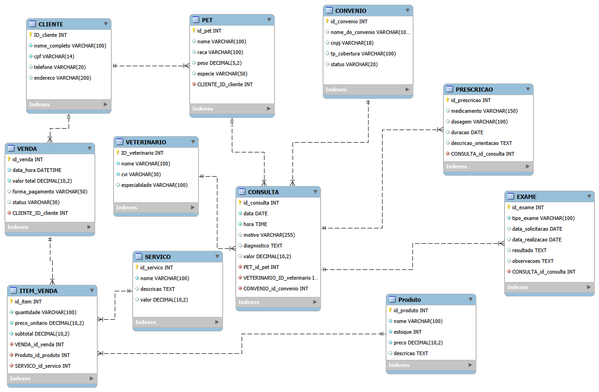

# 🐾 Sistema de Gerenciamento de Pet Shop

## 📌 Sobre o projeto

Projeto acadêmico desenvolvido durante a graduação em
Sistemas de Informação, na disciplina de Banco de Dados.

O objetivo foi realizar a modelagem de um banco de dados
para um sistema de gerenciamento de Pet Shop.

## 🎯 Objetivo

Organizar as informações necessárias para o funcionamento
de um Pet Shop, considerando o cadastro de clientes,
animais, consultas veterinárias, serviços e produtos.

## 🛠️ Tecnologias e ferramentas

- MySQL
- MySQL Workbench
- Modelagem de Banco de Dados
- Modelo Entidade-Relacionamento (MER)

## 📂 Estrutura do projeto

O repositório contém o arquivo:

- `Petshop.mwb` — Modelo de banco de dados desenvolvido
  no MySQL Workbench.

## 📚 Conhecimentos aplicados

- Modelagem de banco de dados relacional
- Identificação de entidades e atributos
- Definição de chaves primárias e estrangeiras
- Relacionamentos entre tabelas
- Organização e estruturação de dados

## 🗂️ Diagrama do Banco de Dados

O diagrama abaixo apresenta a modelagem do banco de dados
do Pet Shop, incluindo suas tabelas e relacionamentos.

## 🎓 Contexto acadêmico

Projeto desenvolvido como atividade prática da disciplina
de Banco de Dados do curso de Sistemas de Informação.

---

⭐ Projeto acadêmico para fins de aprendizado.
